# ecs-web-platform

> Highly available customer website on ECS Fargate behind an ALB across two AZs — self-healing, autoscaling, failure-tested, fully Terraform.

 <!-- last-verified --><!-- /last-verified -->  

## The scenario (fictional)
**Contoso Harbor Supply** — a 200-person marine-parts distributor *(fictional company, for portfolio purposes)*.

Its customer website runs on **one hand-managed EC2/IIS server** in one Availability Zone. Patching is manual and a single AZ outage last year took the site down for **6 hours**. Leadership wants: no single point of failure, no hand-patched servers, and a bill that doesn't surprise anyone.

## Architecture
### Before
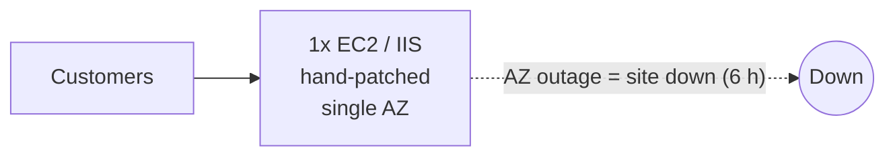
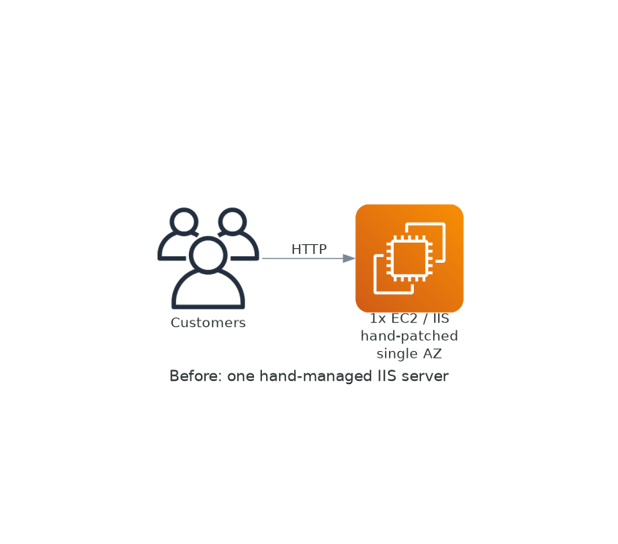

### After
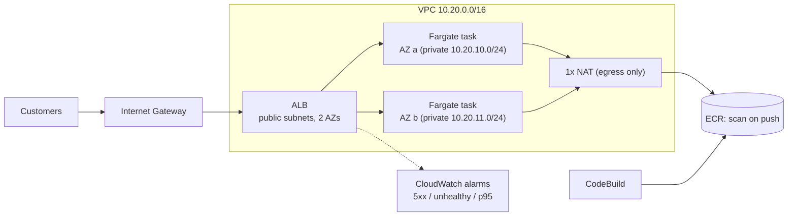
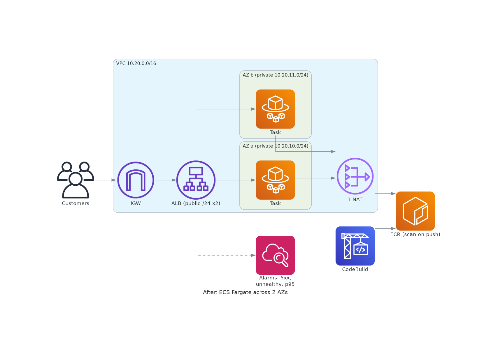

**Subnet math** — VPC `10.20.0.0/16` (65,536 IPs) → `cidrsubnet(vpc, 8, n)` gives /24s (251 usable each):
| Tier | AZ a | AZ b |
|---|---|---|
| Public (ALB, NAT) | 10.20.0.0/24 | 10.20.1.0/24 |
| Private (tasks) | 10.20.10.0/24 | 10.20.11.0/24 |

Numbers 2–9 and 12+ are deliberately left free for future tiers (data, management) without renumbering. Prod uses `10.30.0.0/16` so the two can be peered later.

## Why this service
| Service | Why we chose it | Alternatives rejected (and why) |
|---|---|---|
| ECS on Fargate | No hosts to patch (the legacy pain); 0.25 vCPU/0.5 GB tasks; AZ-spread scheduling | EKS (+$73/mo control plane, K8s ops), App Runner (hides the network design), ECS on EC2 (host patching returns) — ADR 003 |
| Application Load Balancer | L7 health checks on `/health`, per-target 5xx/latency metrics | NLB (L4 only; no HTTP health/metrics) — ADR 004 |
| ECR | Native to ECS, IAM-controlled, scan on push, immutable tags, keep-5 lifecycle | Docker Hub (rate limits, public), GHCR (extra credentials) |
| NAT Gateway (single) | Private tasks need outbound HTTPS to pull images | NAT per AZ (2× fixed cost), VPC endpoints (~$7/mo each per AZ) — ADR 002 |
| CodeBuild | Builds the image in AWS; no Docker on the workstation | Local Docker (unavailable), GitHub Actions push (needs wider CI role) — ADR 001 |
| CloudWatch | Native ALB/ECS metrics + alarms | Third-party APM (cost/scope) |
| AWS Budgets | Mandatory per-project cost alert (tag filter) | — |

## Advanced feature: self-healing multi-AZ + autoscaling, failure-tested
- 2 tasks, one per AZ; ALB health-checks every 10 s; ECS replaces failed tasks automatically; deployment circuit breaker rolls back bad releases.
- Target-tracking autoscaling: CPU 60 %, min 2, max 4.
- Alarms: ALB 5xx, unhealthy hosts, p95 latency.
- **Failure tests** (`tests/smoke/failover.sh`, run by `make verify`) probe the site once a second while tasks are killed.

## Failure-test results (measured on a live deployment)
| Test | User-visible failures | Back to full healthy capacity |
|---|---|---|
| Stop 1 of 2 tasks | **0 / 67** probes failed | 139 s |
| Stop **all tasks in one AZ** (2 of 4) | **0 / 77** probes failed | 158 s |

Why no failures: the other AZ's tasks keep serving while ECS starts replacements. "Full capacity" time includes ECS stopping the task, ALB drain, scheduling a Fargate task, image pull via NAT, and two passing health checks.
Honest caveats: the AZ loss is *simulated* by stopping every task in one AZ (not a real AZ outage); with one NAT in AZ a, a real AZ-a failure would also remove outbound access for AZ b (running tasks keep serving; new image pulls would fail) — a documented tradeoff (ADR 002).

### RTO / RPO
- **RPO = 0**: the site is stateless; code is in Git, images in ECR, config in Terraform.
- **RTO (AZ failure) ≈ 0 for visitors** (measured 0 failed probes), **≈ 2.5 min to restore full redundancy**. The legacy server took 6 h.
- **RTO (loss of a whole region)**: not covered today — see the multi-region design below (target ~5 min with warm standby; hours without).

## Proof it works
This repository is the product. Cloud resources are deployed only to verify the design, capture evidence and give live demos, then destroyed.

| Evidence | |
|---|---|
| Smoke + failure tests (10 checks) | [latest output](docs/evidence/smoke-dev.txt) · [timeline](docs/evidence/failover-timeline.txt) |
| Terraform apply summary (55 resources) | [apply-dev.txt](docs/evidence/apply-dev.txt) |
| Estimated vs actual cost per deployment | [runs.md](docs/evidence/runs.md) |
| Last verified | 2026-11-05 — [LAST_VERIFIED.md](docs/evidence/LAST_VERIFIED.md) |

**Live demo available on request** (deploys in ~8 min incl. NAT + ALB, auto-destroys after the demo).

### Screenshots (account IDs and private IPs redacted)
| | |
|---|---|
| 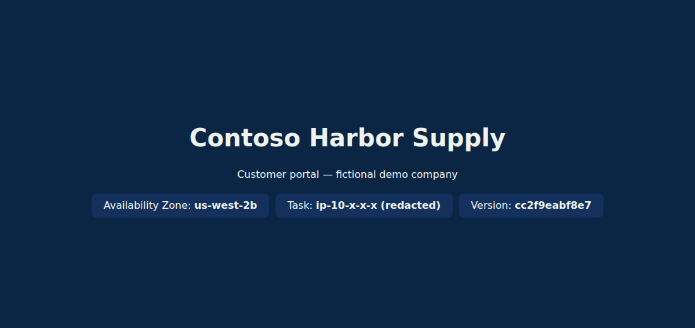 Live site via the ALB DNS name | 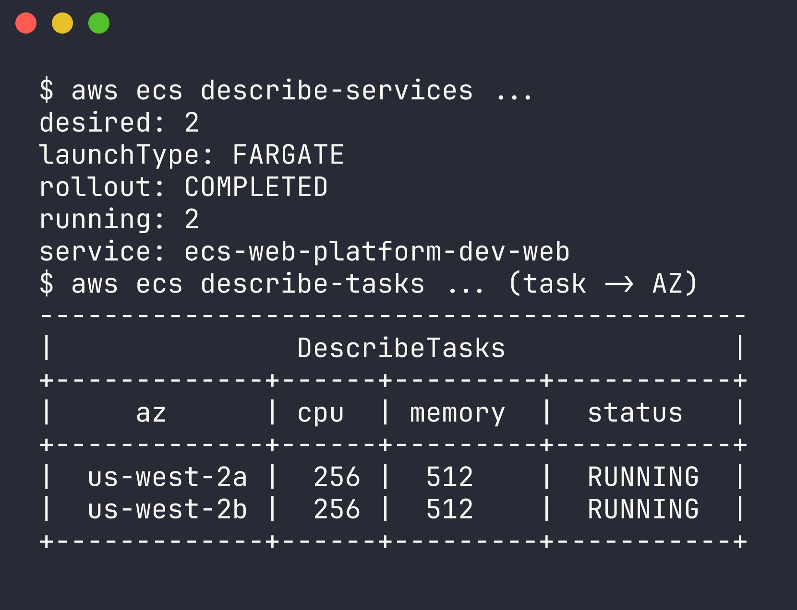 2 tasks across 2 AZs |
| 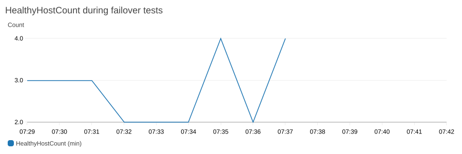 HealthyHostCount during failover | 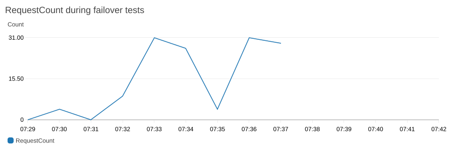 RequestCount during failover |
| 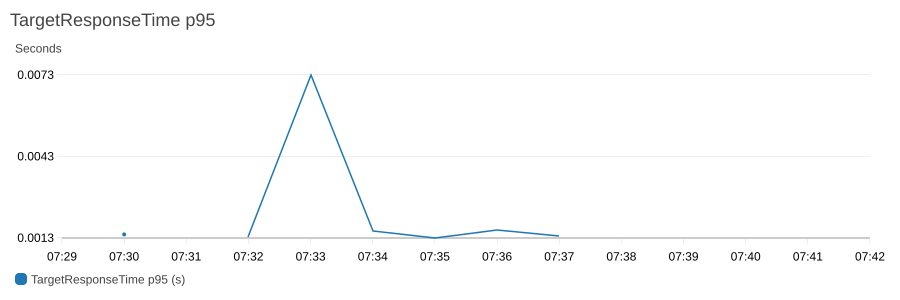 TargetResponseTime p95 | 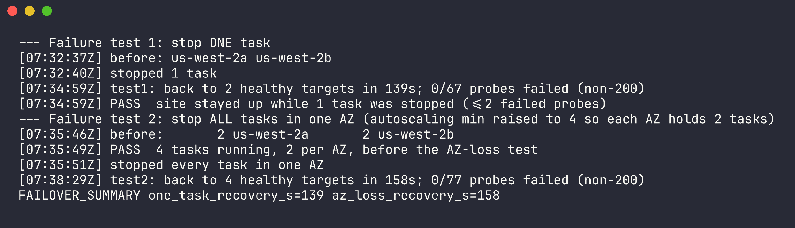 Failover timeline |
| 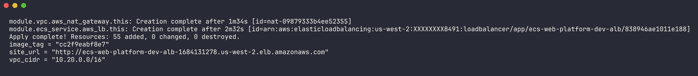 Terraform apply summary | 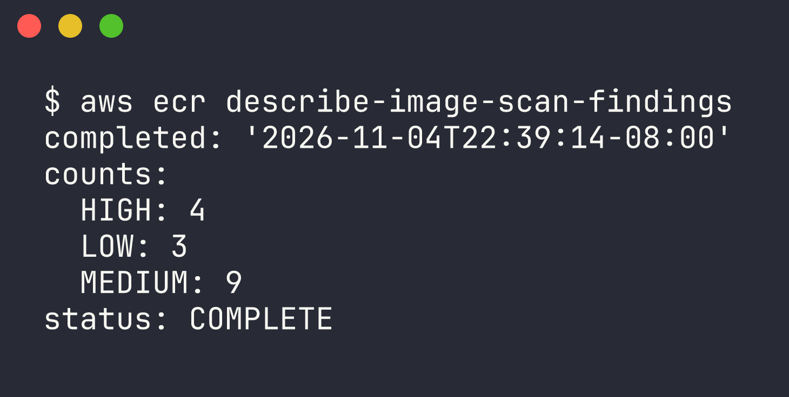 ECR scan on push |

Image scan (python:3.12-slim base): 4 HIGH, 9 MEDIUM, 3 LOW OS-package findings — reported honestly; the fix in production is a scheduled base-image rebuild plus Trivy as a pipeline gate (ADR 008).

## Business impact (modeled / estimated)
- **Downtime avoided:** an AZ failure no longer takes the site down (0 failed probes in test) vs the 6 h outage last year.
- **Ops time saved:** no hand-patched server; image rebuilds and deploys are a pipeline run, and failed tasks heal without a person.
- **Risk reduced:** private tasks (no public IPs), ALB→task-only security groups, scanned immutable images, everything reproducible from Git.
- No revenue-loss figure is claimed: the scenario gives none and none is invented.

## Cost (estimated with Infracost)
| | Hourly | Per 4 h deployment | If left running (monthly) |
|---|---|---|---|
| dev (2 tasks, ALB, 1 NAT) | $0.093 | **$0.37** | $67.60 |

Fixed cost is dominated by the NAT gateway and ALB; Fargate for two 0.25 vCPU tasks is ~$0.03/h. Usage-based charges (data transfer, LCUs, build minutes) are not modeled. Actual run cost will be filled in `docs/evidence/runs.md` once billing data lands.

## Disaster recovery
**Now: multi-AZ** (above). **Designed, not built: multi-region** (skipped for cost/time):
1. **Route 53 failover routing** — primary alias record → region-1 ALB with a health check; secondary → region-2 ALB; TTL 60 s.
2. **CloudFront origin failover** — origin group (primary ALB, secondary region-2 ALB) fails over on 5xx/timeouts without waiting on DNS TTLs.
3. **ECR cross-region replication** — registry replication rule so region 2 already holds every image; no build needed during a disaster.
4. Region 2 runs a minimal "pilot light" (min 1 task) and scales on failover; Terraform modules are reused with another provider alias.

## Production additions
- **HTTPS**: ACM cert, :443 listener with a TLS 1.3 policy, :80 → 301 redirect, ALB access logs to S3, WAF.
- **Route 53 Alias vs CNAME**: use an **Alias A record** for the apex (`example.com`) pointing at the ALB — a CNAME is illegal at a zone apex, Alias is free to query, follows ALB IP changes and supports health-based failover. A CNAME is fine for `www` pointing at a *non-AWS* target, but costs a query and can't live at the apex.
- **Cloudflare WAF/caching in front**: orange-cloud DNS record → ALB; set SSL "Full (strict)" with an origin cert/ACM cert; WAF managed rules + rate limiting; cache static assets; restrict the ALB SG to Cloudflare's published IP ranges (or use authenticated origin pulls) so the WAF can't be bypassed. Trade-off: Route 53 Alias no longer fronts the app (Cloudflare does), so Route 53 failover is replaced by Cloudflare Load Balancing/health checks.
- One NAT per AZ (or VPC endpoints), SNS → pager for alarms, deletion protection on, KMS CMKs, Trivy gate, blue/green via CodeDeploy.
- Pipeline: [azure-pipelines.yml](azure-pipelines.yml) (build → ECR → plan → manual approval → apply → ECS deploy). Written to be correct but **not executed** (ADR 006).

## Repository layout
| Path | What's there |
|---|---|
| `modules/vpc`, `ecr`, `ecs-service`, `codebuild` | Reusable Terraform modules |
| `envs/dev`, `envs/prod` | Environment roots (separate state + tfvars) |
| `app/` | Tiny Python web app + Dockerfile (`/health`, shows serving AZ) |
| `tests/smoke/` | Smoke + failure tests (`make verify`) |
| `docs/evidence/`, `docs/screenshots/` | Proof it works |
| `docs/terraform/` | Explanation of every `.tf` file |
| `docs/decisions/` | ADRs 001–008 |
| `docs/INTERVIEW_PREP.md` | Phone-screen prep grounded in this repo |
| `.github/workflows/` | CI (fmt, validate, tflint, checkov) + plan via OIDC |

## Run it
```bash
make fmt validate lint scan     # static checks
make plan ENV=dev               # plan + cost estimate (ttl = now+4h)
terraform -chdir=envs/dev apply tfplan
make verify ENV=dev             # smoke + failure tests (~7 min)
terraform -chdir=envs/dev destroy
```

## Terraform documentation
Every `.tf` file has a matching page in [docs/terraform/](docs/terraform/): e.g. [vpc](docs/terraform/modules-vpc-main.tf.md), [ecr](docs/terraform/modules-ecr-main.tf.md), [ecs-service](docs/terraform/modules-ecs-service-main.tf.md), [codebuild](docs/terraform/modules-codebuild-main.tf.md), [env wiring](docs/terraform/envs-dev-main.tf.md).

---
*Fictional scenario. Built by Brian Tinawi as a cloud engineering portfolio project.* See [RESUME.md](RESUME.md).
